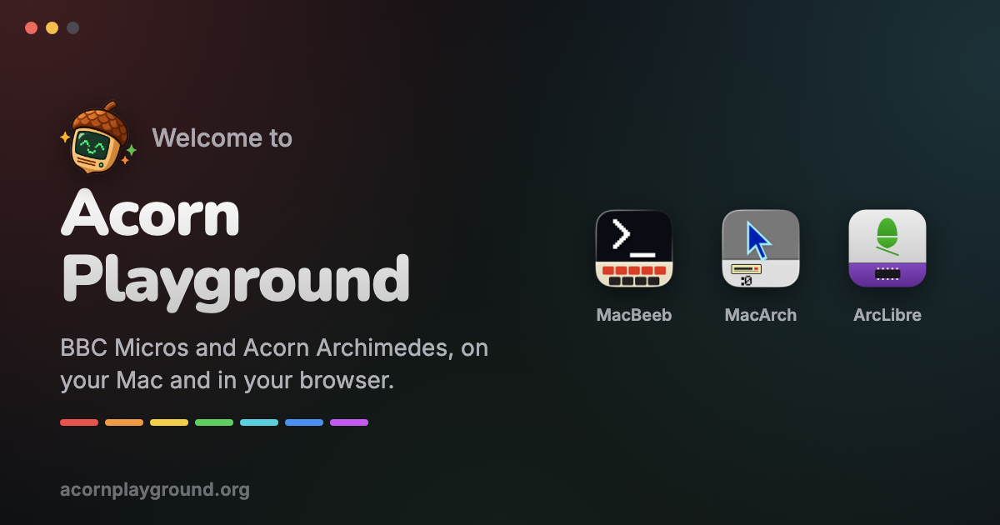
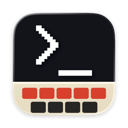
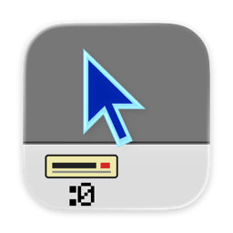
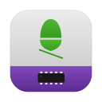

  

<h3 align="center">
  <a href="https://acornplayground.org">acornplayground.org</a>
</h3>

  BBC Micros and Acorn Archimedes, on your Mac and in your browser. 
  Emulators that run them for real, a RISC OS ROM rebuilt from public source, 
  and tools to write and debug their programs in VS Code.

  <a href="https://acornplayground.org/play/macbeeb"><b>Switch on a BBC Micro</b></a> ·
  <a href="https://acornplayground.org/play/macarch"><b>Switch on an Archimedes</b></a> ·
  <a href="https://acornplayground.org/play/mandelbrot"><b>Eight-BBC Mandelbrot</b></a> 
  All three run right there, in your browser. No downloads, nothing to install.

---

<table>
  <tr>
    <td width="96" align="center"></td>
    <td>
      <a href="https://acornplayground.org/macbeeb"><b>MacBeeb</b></a> · <a href="https://github.com/acorn-playground/macbeeb">source</a> 
      The BBC Micro, on your Mac. A cycle-exact Model B, B+, Master 128 or Compact, with second processors, the classics
      ready to play, a debugger for 6502 and BBC BASIC, and classrooms of BBCs on Econet, across the Internet too.
    </td>
  </tr>
  <tr>
    <td width="96" align="center"></td>
    <td>
      <a href="https://acornplayground.org/macarch"><b>MacArch</b></a> · <a href="https://github.com/JamesRandall/macarc">source</a> 
      The Acorn Archimedes, on your Mac. ARM2, ARM3 and ARM250 machines running RISC OS, a shelf of Archimedes
      classics, Econet with Acorn's own file server, and an ARM assembler and debugger.
    </td>
  </tr>
  <tr>
    <td width="96" align="center"></td>
    <td>
      <a href="https://acornplayground.org/arclibre"><b>ArcLibre</b></a> · <a href="https://github.com/acorn-playground/ArcLibre">source</a> 
      A free ROM for the Archimedes, restored from RISC OS's public source. It starts the desktop, runs Lemmings,
      Elite and Impression II, and it's the RISC OS MacArch boots in your browser.
    </td>
  </tr>
  <tr>
    <td width="96" align="center"></td>
    <td>
      <a href="https://acornplayground.org/vscode"><b>VS Code extensions</b></a> ·
      <a href="https://github.com/acorn-playground/vscode-macbeeb">MacBeeb</a> ·
      <a href="https://github.com/acorn-playground/vscode-macarch">MacArch</a> 
      Press F5 and your 6502 or ARM assembler, or BBC BASIC, is assembled, put on a disc and run on a BBC Micro or an
      Archimedes, with breakpoints in your own source and stepping back as well as forward.
    </td>
  </tr>
  <tr>
    <td width="96" align="center"></td>
    <td>
      <a href="https://github.com/acorn-playground/cloudflare-econet"><b>Internet Econet</b></a> 
      Econet over the Internet. Share a link or read out a code, and BBC Micros and Archimedes on different Macs and
      browsers join one network, talking with Acorn's own network software: file servers, printers, <code>*I AM</code>.
    </td>
  </tr>
</table>

---

  
    Free software by <a href="https://jamesdrandall.com">James Randall</a>, built on the work of many others. 
    BBC Micro, Acorn, Archimedes and RISC OS are trademarks of their owners. Acorn Playground isn't affiliated with them.
  

